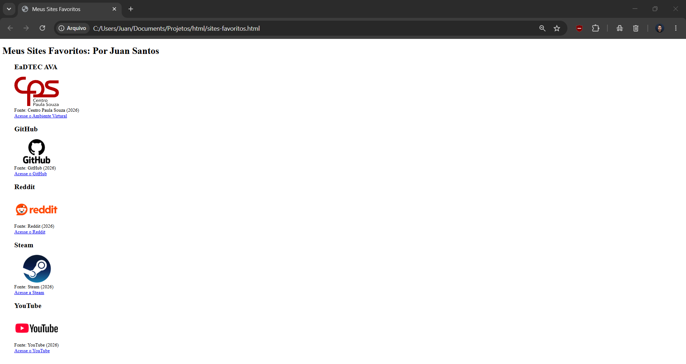

# 🌐 Meus Sites Favoritos

Página web simples em HTML que reúne alguns dos meus sites favoritos, com logotipo, legenda de fonte e link de acesso direto para cada um.

<p align="center">
  
</p>

## 🔗 Sites incluídos

| Site | Descrição | Link |
|------|-----------|------|
| **EaDTEC AVA** | Ambiente Virtual de Aprendizagem do Centro Paula Souza | [eadtec.cps.sp.gov.br](https://eadtec.cps.sp.gov.br/) |
| **GitHub** | Plataforma de hospedagem de código e controle de versão | [github.com](https://github.com/) |
| **Reddit** | Rede social de comunidades e discussões | [reddit.com](https://www.reddit.com/) |
| **Steam** | Plataforma de distribuição de jogos digitais | [store.steampowered.com](https://store.steampowered.com/) |
| **YouTube** | Plataforma de compartilhamento de vídeos | [youtube.com](https://www.youtube.com/) |

Imagens obtidas do site [1000logos.net](https://1000logos.net/) e do site do Centro Paula Souza.

## 📁 Estrutura do projeto

```
.
├── index.html
├── README.md
└── imagens/
    └── print.png
```

**Autor:** Juan Santos